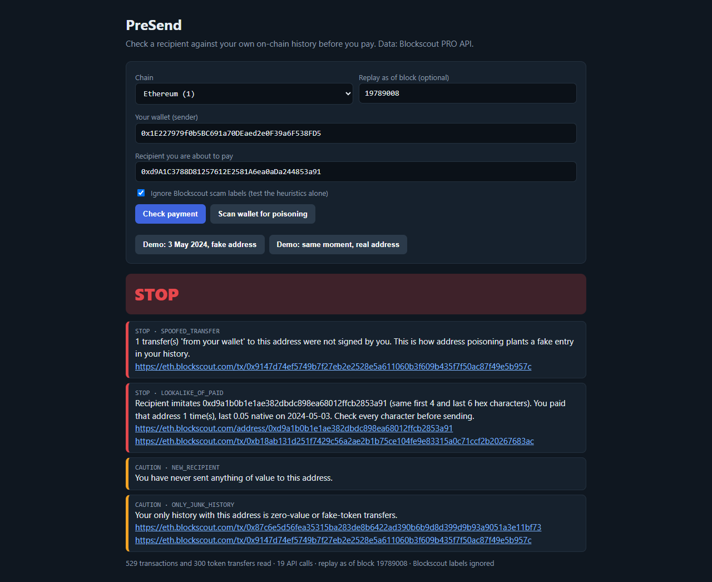
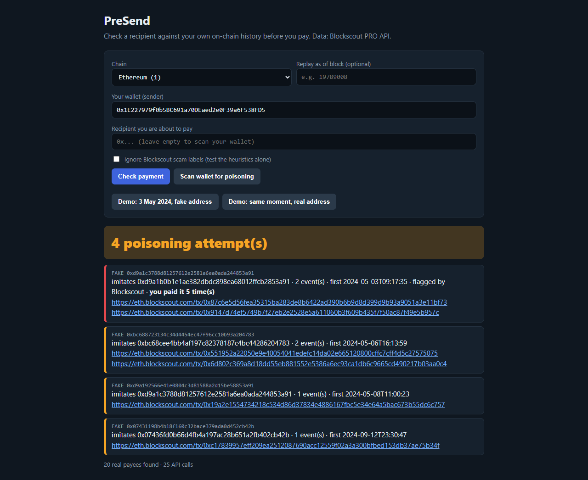
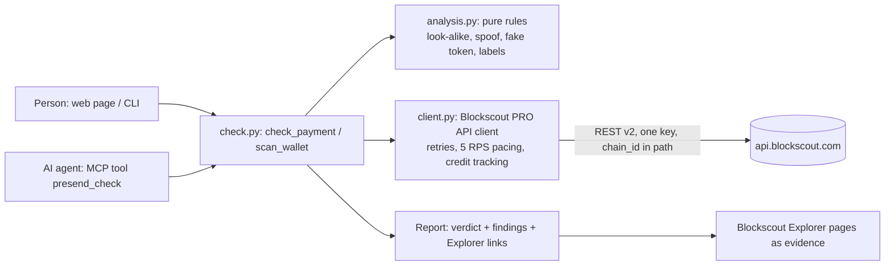

# PreSend

**Check a recipient against your own on-chain history before you pay.** PreSend stops
address-poisoning look-alikes, spoofed "from you" transfers and fake tokens before money
leaves the wallet. It works for people (web page, CLI) and for AI agents (MCP tool), and all
of its data comes from the **Blockscout PRO API**.

Status: **prototype** (Sprint 1 of the Blockscout PRO API Buildathon). Tested on recorded and
live Blockscout data; no external users yet. Not financial or security advice.



Demo video (3 min 27 s, synthetic voice): [docs/demo/presend_demo.mp4](docs/demo/presend_demo.mp4)

## The problem, on a real case

On 3 May 2024 a wallet sent **1,155 WBTC** (about 68 million USD at the time) to
`0xd9A1C378…853a91` instead of `0xd9A1b0B1…853a91`. Blockscout shows how it happened:

1. 09:14 UTC: the owner sends a 0.05 ETH test payment to the real address `0xd9A1b0B1…853a91`
   ([tx](https://eth.blockscout.com/tx/0xb18ab131d251f7429c56a2ae2b1b75ce104fe9e83315a0c71ccf2b20267683ac)).
2. 09:17 UTC: an attacker's batch transaction makes a fake ERC-20 called "ETH" log a transfer
   **from the owner's wallet** to the look-alike `0xd9A1C378…853a91`. The owner never signed it;
   the transaction was sent by `0x517DC8…1Db2`
   ([tx](https://eth.blockscout.com/tx/0x9147d74ef5749b7f27eb2e2528e5a611060b3f609b435f7f50ac87f49e5b957c)).
3. 10:31 UTC: the owner copies the "recent recipient" from history and sends 1,155 WBTC to the
   fake address ([tx](https://eth.blockscout.com/tx/0x3374abc5a9c766ba709651399b6e6162de97ca986abc23f423a9d893c8f5f570)).

PreSend replays the check **as of block 19789008, one block before step 3, with Blockscout's
scam labels switched off** (they were added later, so using them would be hindsight). Verdict:

```
PreSend verdict: STOP
[STOP]    SPOOFED_TRANSFER: 1 transfer(s) 'from your wallet' to this address were not signed by you.
[STOP]    LOOKALIKE_OF_PAID: Recipient imitates 0xd9a1b0b1e1ae382dbdc898ea68012ffcb2853a91
          (same first 4 and last 6 hex characters). You paid that address 1 time(s), last 0.05
          native on 2024-05-03. Check every character before sending.
[CAUTION] NEW_RECIPIENT: You have never sent anything of value to this address.
[CAUTION] ONLY_JUNK_HISTORY: Your only history with this address is zero-value or fake-token transfers.
```

The same check for the real address at the same moment returns **OK** (`KNOWN_RECIPIENT`).
Today, with labels on, Blockscout's own scam flag on the fake address is shown too
(`RECIPIENT_FLAGGED`).

## What it checks

| Code | Severity | Built from (Blockscout PRO API) |
|---|---|---|
| `RECIPIENT_FLAGGED` | stop | `GET /addresses/{addr}`: `is_scam`, `reputation`, phishing tags and notes |
| `SPOOFED_TRANSFER` | stop | `/addresses/{wallet}/transactions` + `/token-transfers` (+ `/transactions/{hash}` for older items): a transfer "from you" whose transaction you did not send. EOA wallets only; for contract wallets (Safe, ERC-4337) no such claim is made |
| `LOOKALIKE_OF_PAID` | stop (caution if you also paid the recipient) | your `/transactions` and `/token-transfers`: the recipient shares 7+ hex characters at both ends with an address you really paid |
| `ONLY_JUNK_HISTORY` | caution | zero-value transfers or fake tokens (look-alike symbols such as Cyrillic "WВТC", ERC-20 named like the native coin, major symbol with no price and few holders) |
| `NEW_RECIPIENT` / `KNOWN_RECIPIENT` | caution / info | your signed outgoing payments |
| `FRESH_ADDRESS` | caution | `/addresses/{addr}/counters` |
| `UNVERIFIED_CONTRACT` | caution | `is_contract`, `is_verified` |
| `TOKEN_SUSPICIOUS` | caution | `GET /tokens/{addr}` for the token you are about to send |

Verdict: **STOP** if any stop finding, **CAUTION** if any caution, otherwise **OK**.
`presend scan` lists every poisoning attempt against a wallet: look-alikes of real payees that
reached it through junk or spoofed transfers, and whether the wallet later paid them.



## Architecture



- `presend/client.py`: one base URL for every chain (`https://api.blockscout.com/{chain_id}/api/v2/...`),
  keyset pagination via `next_page_params`, pages newer than a replay block are skipped
  without using the page budget, `x-credits-remaining` is tracked.
- `presend/analysis.py`: no network, fully unit-tested.
- `presend/check.py`: orchestration and the report. At most 8 extra transaction lookups per check.
- Interfaces: `presend/cli.py`, `presend/web.py` (stdlib HTTP server, key stays server-side),
  `presend/mcp_server.py` (MCP, stdio).

A typical check costs 10-20 API calls (about 300-500 credits); the free tier gives 100,000
credits a day.

## Run it

Get a free key at [dev.blockscout.com](https://dev.blockscout.com) (keys start with `proapi_`).

```bash
pip install -e ".[mcp]"
export BLOCKSCOUT_API_KEY=proapi_...

# replay the May 2024 case
presend check --from 0x1E227979f0b5BC691a70DEaed2e0F39a6F538FD5 \
  --to 0xd9A1C3788D81257612E2581A6ea0aDa244853a91 --as-of-block 19789008 --no-labels
# exit code: 0 OK, 1 CAUTION, 2 STOP (usable in scripts and CI)

presend scan --wallet 0x1E227979f0b5BC691a70DEaed2e0F39a6F538FD5 --pages 14

python -m presend.web          # http://127.0.0.1:8765, has two demo buttons
```

### For AI agents (MCP)

```json
{"mcpServers": {"presend": {"command": "presend-mcp",
  "env": {"BLOCKSCOUT_API_KEY": "proapi_..."}}}}
```

Tools: `presend_check(sender, recipient, chain_id=1, token=None, as_of_block=None, use_labels=True)`
and `presend_scan(wallet, chain_id=1, pages=6)`. The tool description tells the agent not to send
when the verdict is STOP. An agent that pays by x402 or a plain transfer can call it first.
`scripts/mcp_smoke.py` starts the server and calls the tool over stdio.

## Tests

```bash
pip install -e ".[test]"
pytest -q          # 39 tests, offline
```

Integration tests replay recorded Blockscout answers for the May 2024 case
(`tests/fixtures/may2024_wbtc.json.gz`, recorded with `scripts/record_fixtures.py`; the key is not stored).

## Limits (honest list)

- History depth: by default the last 6 pages (300 items) of transactions and of token transfers.
  Busy wallets need `--pages`; a look-alike of a payee older than the window is not seen.
- Look-alike rule: 7+ matching hex characters at the two ends, at least 3 at each. Attackers who
  match fewer characters are missed; a random false match has odds of about 4 in a billion.
- Replay mode uses current Blockscout labels and counters unless `--no-labels`; counters are
  skipped in replay.
- Base, Polygon and zkSync are not on the free PRO API tier (Blockscout notice, October 2026).
- Contract wallets: the spoofed-transfer test is off (their transactions are sent by owners or bundlers).
- The local web server has no auth: keep it on 127.0.0.1, or anyone who reaches it spends your API credits.
- Prototype: no external users yet. It warns; it does not block a wallet.

External code review (Google Jules) and what was fixed: [REVIEW.md](REVIEW.md).

## License

MIT
